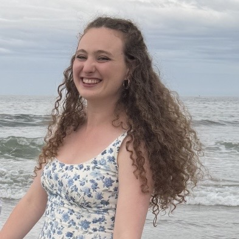

I am a PhD student in math at the University of Chicago, advised by Ewain Gwynne.

My research is in probability theory and random geometry. I am especially interested in the metric structure of continuum random geometries arising as scaling limits of discrete random systems. During my PhD, I have primarily worked on Liouville quantum gravity.

**Email:** bcharper@uchicago.edu  
**Office:** Eckhart 110-A

<!-- Add files/cv.pdf, then uncomment this link.
[Curriculum vitae](files/cv.pdf)
-->

## Papers

1. **Dimension lower bounds in random geometry via Lipschitz functions**, with [Manan Bhatia](https://mananbhatia1701.github.io/manan/) and [Ewain Gwynne](https://math.uchicago.edu/~ewain/). Preprint, 2026.
   [arXiv](https://arxiv.org/pdf/2606.10496)

## Talks and posters

 - [Workshop on Random Metric Spaces](https://www.math.uestc.edu.cn/info/1252/10320.htm), University of Electronic Science and Technology of China, Chengdu, China, January 2027 (invited talk)
 - [Workshop on Discrete and Continuous Random Trees](https://randomtrees.matem.unam.mx/), Universidad Nacional Autónoma de México, Mexico City, Mexico, October 2026 (short talk)
 - [Workshop on Random Explorations](https://www.imsi.institute/activities/random-explorations/), Institute for Mathematical and Statistical Innovation, Chicago, IL, USA, July 2026 (poster)
 - [Peking Summer Program in Probability](https://faculty.bicmr.pku.edu.cn/~xinsun/program2026.html), Peking University, Beijing, China, June 2026 (poster)
 - [Seminar on Stochastic Processes](https://www.math.union.edu/~marianop/SSP2026/), Union College, Schenectady, NY, USA, March 2026 (lightning talk + poster)

## Teaching

- Fall 2025: Math 152 (Calculus II), Instructor of Record
- Spring 2024: Math 235 (Markov Chains, Martingales, and Brownian Motion), College Fellow
- Winter 2024: Math 270 (Basic Complex Variables), College Fellow
- Fall 2023: Math 207 (Honors Analysis in $\mathbb{R}^n$ I), College Fellow

## Websites of friends

[Catherine Li](https://catlimath.github.io/) · [Isabelle Steinmann](https://sites.google.com/view/isabellesteinmann/home) · [Katie Gravel](https://sites.google.com/view/katiegravel/home) · [Sanath Devalapurkar](https://sanathdevalapurkar.github.io/) · [Victor Hugo Almendra Hernandez](https://victoralmh.github.io/) · [Yuyang Feng](https://sites.google.com/view/yuyangfeng/home?authuser=0) · [Full list](https://mathematics.uchicago.edu/people/#graduate-students)
